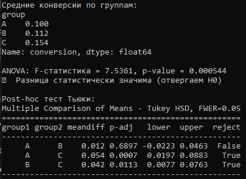
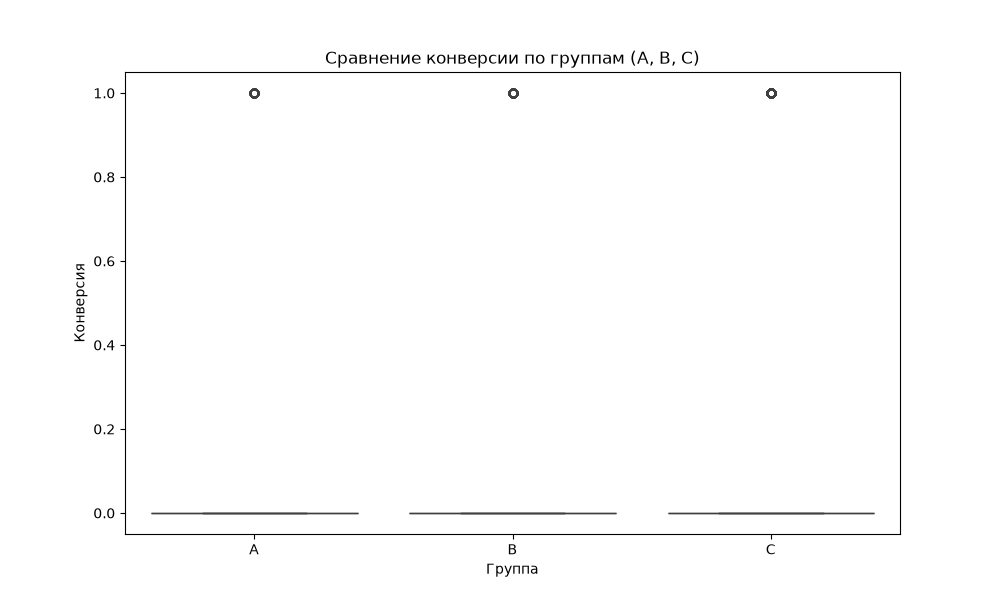
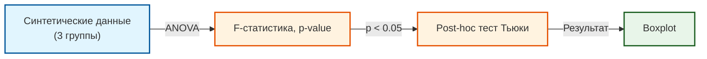

# 📊 A/B Testing: ANOVA (Multi-Group)

Pet-проект: сравнение трех и более групп с использованием **ANOVA** (дисперсионный анализ). Дополняет проект `ab-testing-simulation` (Z-тест для двух групп).

## 📸 Скриншоты

**Результаты ANOVA и post-hoc теста Тьюки:**



**Визуализация конверсии по группам:**



## 🎯 Зачем это

В A/B-тестировании часто сравнивают не две группы (A vs B), а три и более (A vs B vs C). Для этого используют **ANOVA** (Analysis of Variance). Если ANOVA показывает значимую разницу, делают **post-hoc тест** (например, Тьюки), чтобы понять, какие именно группы отличаются.

## 📖 Что такое ANOVA (кратко)

- **H0 (нулевая гипотеза):** Все группы имеют одинаковое среднее.
- **H1 (альтернативная):** Хотя бы одна группа отличается.
- **F-статистика:** Отношение дисперсии между группами к дисперсии внутри групп. Чем больше F, тем вероятнее, что группы различаются.
- **p-value:** Если p < 0.05 — отвергаем H0 (разница значима).

## 🏗 Архитектура



## 📂 Структура

```
ab-testing-anova/
├── scripts/
│   └── anova_test.py      # Скрипт с ANOVA и Тьюки
├── assets/
│   ├── anova_console.png  # Скриншот консоли
│   └── anova_boxplot.png  # График
├── README.md
└── requirements.txt
```

## 🚀 Запуск

1. Установи зависимости:
```bash
pip install -r requirements.txt
```

2. Запусти скрипт:
```bash
python scripts/anova_test.py
```

## 📊 Результаты

- **Средние конверсии:** A = 10.0%, B = 11.2%, C = 15.4%.
- **ANOVA:** F = 7.5361, p-value = 0.000544 (разница значима).
- **Post-hoc Тьюки:** Группа C отличается от A (p-adj = 0.0007) и от B (p-adj = 0.0113). Группы A и B не отличаются (p-adj = 0.6897).

## 🔗 Связанные проекты

- [`ab-testing-simulation`](https://github.com/nconichtchenko-arch/ab-testing-simulation) — Z-тест для двух групп.

## 📫 Контакты

- **GitHub:** [github.com/nconichtchenko-arch](https://github.com/nconichtchenko-arch)
- **Email:** pavloni@mail.ru
- **Формат работы:** удалённо
